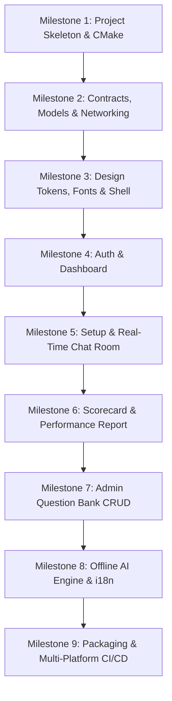

# Document 06: Testing, CI/CD, Packaging & Milestones

This document defines the quality assurance strategy, cross-platform packaging workflows, GitHub Actions CI/CD pipeline, and the step-by-step phased execution roadmap for the C++ desktop migration.

---

## 1. Automated Testing Suite

### Unit Testing with GoogleTest (`tests/unit/TestApiContracts.cpp`)

Ensures bidirectional JSON roundtrips between C++ structs and the ASP.NET Core API DTO formats:

```cpp
#include <gtest/gtest.h>
#include "models/ApiContracts.hpp"

using namespace devdialogue::models;

TEST(ApiContractsTest, SerializeInterviewSummary) {
    InterviewSummary summary;
    summary.id = "interview-123";
    summary.userId = "user-abc";
    summary.direction = InterviewDirection::Frontend;
    summary.level = InterviewLevel::Junior;
    summary.language = InterviewLanguage::Uk;
    summary.stage = InterviewStage::HardSkills;
    summary.status = InterviewStatus::Completed;
    summary.score = 85;
    summary.questionCount = 5;
    summary.createdAt = "2026-11-04T12:00:00Z";
    summary.updatedAt = "2026-11-04T12:30:00Z";

    nlohmann::json jsonDoc = summary;
    EXPECT_EQ(jsonDoc["id"], "interview-123");
    EXPECT_EQ(jsonDoc["direction"], "frontend");
    EXPECT_EQ(jsonDoc["score"], 85);

    InterviewSummary deserialized = jsonDoc.get<InterviewSummary>();
    EXPECT_EQ(deserialized.id, summary.id);
    EXPECT_EQ(deserialized.direction, InterviewDirection::Frontend);
    EXPECT_EQ(deserialized.score.value(), 85);
}

TEST(MockAiEngineTest, GeneratesDeterministicJuniorQuestions) {
    devdialogue::services::MockAiEngine engine;
    std::string firstQ = engine.generateFirstQuestion(
        InterviewDirection::Frontend,
        InterviewLevel::Junior,
        InterviewLanguage::En
    );

    EXPECT_FALSE(firstQ.empty());
    EXPECT_NE(firstQ.find("Frontend"), std::string::npos);
}
```

### ViewModel Reactive Testing with Qt Test (`QSignalSpy`)

Verifies that state modifications in ViewModels properly trigger Qt signals consumed by QML:

```cpp
#include <QtTest>
#include "viewmodels/AuthViewModel.hpp"

class TestAuthViewModel : public QObject {
    Q_OBJECT

private slots:
    void testAdminViewToggleEmitsSignal() {
        auto authService = std::make_shared<devdialogue::services::AuthService>(nullptr, nullptr);
        devdialogue::viewmodels::AuthViewModel vm(authService);

        QSignalSpy spy(&vm, &devdialogue::viewmodels::AuthViewModel::adminViewChanged);
        QVERIFY(vm.isAdminViewActive());

        vm.toggleAdminView();
        QCOMPARE(spy.count(), 1);
        QVERIFY(!vm.isAdminViewActive());
    }
};
```

---

## 2. Packaging & Native Installer Distribution

### Windows: `windeployqt` + Inno Setup Script

To produce an isolated, zero-dependency installer on Windows:

1. **Deploy Qt Runtimes:**
   ```powershell
   windeployqt.exe --qmldir apps/desktop/qml --release --compiler-runtime apps/desktop/build/Release/DevDialogue.exe
   ```
2. **Inno Setup Script (`installer.iss`):**
   ```iss
   [Setup]
   AppName=Dev Dialogue
   AppVersion=1.0.0
   DefaultDirName={autopf}\DevDialogue
   DefaultGroupName=Dev Dialogue
   OutputDir=dist
   OutputBaseFilename=DevDialogue-Setup-x64
   Compression=lzma2/ultra64
   SolidCompression=yes

   [Files]
   Source: "apps\desktop\build\Release\*"; DestDir: "{app}"; Flags: ignoreversion recursesubdirs

   [Icons]
   Name: "{group}\Dev Dialogue"; Filename: "{app}\DevDialogue.exe"
   Name: "{autodesktop}\Dev Dialogue"; Filename: "{app}\DevDialogue.exe"
   ```

---

## 3. GitHub Actions CI/CD Matrix (`.github/workflows/desktop.yml`)

```yaml
name: Desktop App CI/CD

on:
  push:
    branches: [main]
    paths:
      - 'apps/desktop/**'
      - '.github/workflows/desktop.yml'
  pull_request:
    branches: [main]

jobs:
  build-and-test:
    name: Build (${{ matrix.os }})
    runs-on: ${{ matrix.os }}
    strategy:
      fail-fast: false
      matrix:
        os: [windows-latest, ubuntu-24.04, macos-14]

    steps:
      - name: Checkout Repository
        uses: actions/checkout@v4
        with:
          submodules: recursive

      - name: Install Qt 6.7
        uses: jurplel/install-qt-action@v3
        with:
          version: '6.7.2'
          modules: 'qtdeclarative qtquickcontrols2 qtsvg'

      - name: Setup vcpkg Cache
        uses: actions/cache@v4
        with:
          path: ~/.vcpkg
          key: ${{ runner.os }}-vcpkg-${{ hashFiles('apps/desktop/vcpkg.json') }}

      - name: Configure CMake
        run: |
          cmake -B build -S apps/desktop \
            -DCMAKE_BUILD_TYPE=Release \
            -DCMAKE_TOOLCHAIN_FILE=${{ github.workspace }}/vcpkg/scripts/buildsystems/vcpkg.cmake

      - name: Build Executable
        run: cmake --build build --config Release --parallel

      - name: Run Test Suite
        run: ctest --test-dir build -C Release --output-on-failure
```

---

## 4. Phased 9-Milestone Implementation Roadmap



### Detailed Milestone Breakdown

| Milestone | Key Deliverables | Definition of Done (DoD) |
| :--- | :--- | :--- |
| **M1: Basic Project Structure & CMake** *(First Task)* | • `apps/desktop/` tree layout<br>• `CMakeLists.txt` with Qt6 & `vcpkg.json`<br>• `main.cpp` initializing QML engine<br>• Empty window shell with custom title bar | App builds via `cmake --build` and opens a blank 1200x800 dark window with Geist font loaded. |
| **M2: Contracts, Models & Networking** | • `ApiContracts.hpp` C++20 DTOs<br>• `nlohmann::json` serialization<br>• `ApiClient` with `QNetworkAccessManager`<br>• Automated DTO unit tests with GoogleTest | Full serialization and successful GET/POST roundtrips to ASP.NET Core API or mock server. |
| **M3: Design Tokens, Fonts & Shell** | • `Theme.qml`, `Typography.qml`, `Icons.qml`<br>• Reusable `TactileButton` & `DarkCard`<br>• `Navbar.qml` with logo, view-mode toggle & status pill<br>• View routing via `StackLayout` | Navigation bar matches Next.js web aesthetic at 60/120 FPS with working tab clicks. |
| **M4: Auth, Credentials & Dashboard** | • `SecureStorage` (DPAPI/Keychain)<br>• `AuthViewModel` & `LoginView.qml`<br>• `DashboardViewModel` & `DashboardView.qml`<br>• KPI cards & interview history list | User can sign in, token persists across app restarts, dashboard loads real stats from API. |
| **M5: Setup & Interactive Chat Room** | • `SetupView.qml` with 5 track cards & level pills<br>• `ChatRoomView.qml` with message bubbles<br>• Auto-scrolling `ListView`<br>• Multiline input area with Enter/Shift+Enter | Candidate can select track, initiate session, exchange messages with AI, and track answer counts. |
| **M6: Scorecard & Performance Report** | • `ReportView.qml`<br>• Circular score gauge indicator<br>• Strengths & Weaknesses cards<br>• Clickable external URLs via `Qt.openUrlExternally`<br>• Question breakdown table | Completing an interview displays animated score, evaluator commentary, and study links. |
| **M7: Admin Question Bank Management** | • `AdminView.qml` with direction filters<br>• Active/Inactive toggle switches<br>• Add/Edit Question dialog modal<br>• Admin view switcher in Navbar | Administrators can manage questions; normal candidates see restricted access banner. |
| **M8: Offline AI Engine & Dynamic i18n** | • Native `MockAiEngine.cpp` question pools<br>• Offline fallback when backend is disconnected<br>• Qt Linguist `QTranslator` integration<br>• Instant UK <-> EN runtime switching | App functions 100% offline with zero network; toggling language updates all UI instantly. |
| **M9: Packaging & Multi-Platform CI/CD** | • `windeployqt` bundle script<br>• Inno Setup Windows installer<br>• GitHub Actions CI matrix<br>• Release asset publishing | Pull requests run automated unit tests; tagging a release generates downloadable desktop installers. |

